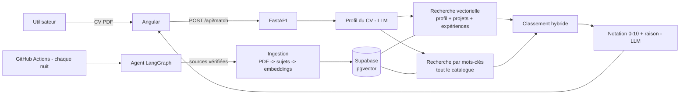

# PFE Finder

> Dépose ton CV, reçois les sujets de PFE tunisiens qui te correspondent, avec la raison du match et la procédure pour postuler.

PFE Finder est une application **RAG** (Retrieval-Augmented Generation) gratuite : les sujets des PFE books d'entreprises tunisiennes sont extraits, vectorisés et stockés dans une base ; un **agent LangGraph** autonome découvre de nouveaux PFE books chaque nuit. **Le CV de l'utilisateur n'est jamais stocké.**

    

## Fonctionnalités

- Analyse d'un CV (PDF, français ou anglais) et extraction d'un profil structuré : compétences, domaines, projets, expériences.
- Classement des sujets de PFE **réellement pertinents** pour ce profil, chacun avec une note et une raison en une phrase.
- Filtre par ville (une ou plusieurs) et par entreprise.
- Fiche détaillée d'un sujet et rubrique « Comment postuler » (contact, portail, pièces demandées, date limite).
- Alimentation automatique de la base : découverte de PFE books, extraction, validation, indexation.

## Architecture



**Matching.** Les candidats viennent de deux recherches complémentaires : vectorielle (le profil global, puis chaque projet et chaque expérience séparément, pour qu'un sujet très proche d'un seul projet ne soit pas dilué) et par mots-clés sur tout le catalogue (pondération IDF et insistance du CV). Le classement hybride combine 0,4 vecteur et 0,6 mots-clés. Un LLM juge ensuite les candidats ; seuls les sujets notés **6/10 ou plus** sont affichés.

**Résilience.** Les LLM gratuits ont des quotas : Gemini est utilisé en premier, Groq en secours, et si aucun LLM ne répond, le classement hybride est affiché sans raisons.

**Agent.** Le LLM propose des sources, le code décide : robots.txt, liste blanche de domaines, taille maximale, quota de PDF par jour. Une source en échec reste en file pour le lendemain.

Détails et correspondance avec les étapes d'un RAG : [`docs/ARCHITECTURE.md`](docs/ARCHITECTURE.md).

## Stack

| Couche | Technologies |
|---|---|
| Frontend | Angular 18 (standalone, lazy loading) |
| API | FastAPI, Pydantic |
| RAG / agent | LangChain, LangGraph |
| LLM | Gemini (principal), Groq (secours), Ollama (extraction nocturne) |
| Embeddings | `gemini-embedding-001`, 768 dimensions |
| Base | Supabase : PostgreSQL + pgvector (index HNSW, cosinus) |
| Automatisation | GitHub Actions (CI + agent nocturne) |

## Démarrage local

**Prérequis** : Python 3.11, Node 20, un projet Supabase, une clé Gemini (gratuite).

1. **Base** : dans le SQL Editor de Supabase, exécuter `database/001_schema.sql` puis `database/002_match_function.sql`.
2. **Backend**
   ```bash
   cd backend
   python -m venv .venv
   .venv\Scripts\activate            # Linux/macOS : source .venv/bin/activate
   pip install -r requirements-dev.txt
   cp .env.example .env              # puis renseigner les clés
   python -m scripts.check_connection
   pytest
   uvicorn pfefinder.api.main:app --reload   # http://localhost:8000/docs
   ```
3. **Données** : ingérer un PFE book.
   ```bash
   python -m pfefinder.cli.ingest_book mon-book.pdf --url https://site.tn/mon-book.pdf
   ```
4. **Frontend**
   ```bash
   cd frontend
   npm install
   npm start                         # http://localhost:4200
   ```

## Configuration

Variables d'environnement (`backend/.env`, modèle dans `.env.example`) :

| Variable | Rôle |
|---|---|
| `SUPABASE_URL`, `SUPABASE_KEY` | Base de données (clé `service_role`, côté serveur uniquement) |
| `GOOGLE_API_KEY` | Gemini : LLM et embeddings |
| `GROQ_API_KEY`, `GROQ_MODEL` | LLM de secours (optionnel, gratuit) |
| `OLLAMA_MODEL`, `OLLAMA_BASE_URL`, `LLM_PREFER_LOCAL` | LLM local pour l'extraction nocturne |
| `MAX_PDFS_PAR_JOUR` | Quota quotidien d'ingestion (10 par défaut) |
| `ALLOWED_ORIGINS` | Origines CORS autorisées |

## API

| Méthode | Route | Description |
|---|---|---|
| `POST` | `/api/match` | CV (PDF) et villes optionnelles, renvoie les sujets classés |
| `GET` | `/api/cities` | Villes disponibles |
| `GET` | `/api/subjects/{id}` | Détail d'un sujet |
| `GET` | `/api/subjects/{id}/apply` | Informations pour postuler |
| `GET` | `/api/health` | Santé du service |

## Agent nocturne

Le workflow [`.github/workflows/agent.yml`](.github/workflows/agent.yml) s'exécute chaque nuit : expiration des sujets périmés, exploration des sites de confiance (`seeds` de `domains.json`) pour trouver des PDF, ingestion de la file (extraction par Ollama sur le runner, Groq et Gemini en secours). Il peut aussi être lancé à la main (`workflow_dispatch`) pour un test. Secrets GitHub requis : `SUPABASE_URL`, `SUPABASE_KEY`, `GOOGLE_API_KEY`, `GROQ_API_KEY`.

## Qualité

- Tests unitaires (`pytest`) exécutés par la CI à chaque push.
- Séparation stricte des couches : routes, services, RAG, repositories.
- Le LLM propose, le code décide ; le contenu externe (CV, PDF, pages web) est traité comme une donnée, jamais comme une instruction.

## Respect des sources

robots.txt et Content-Signal respectés, aucun accès aux réseaux sociaux, ingestion automatique limitée aux domaines de `agent/domains.json`, 10 PDF par jour maximum. Aucun PDF n'est hébergé : seuls les faits utiles et le lien vers la source sont conservés. Pour demander le retrait d'un sujet, ouvrir une issue sur ce dépôt.

## Limites connues

- Les quotas des LLM gratuits peuvent ralentir l'analyse ou faire passer l'application en mode dégradé (classement sans raisons).
- La qualité du classement n'est pas encore mesurée numériquement (évaluation précision@10 prévue).

## Auteur

**Firas Ben Hmida**, étudiant ingénieur en génie logiciel à ESPRIT.
